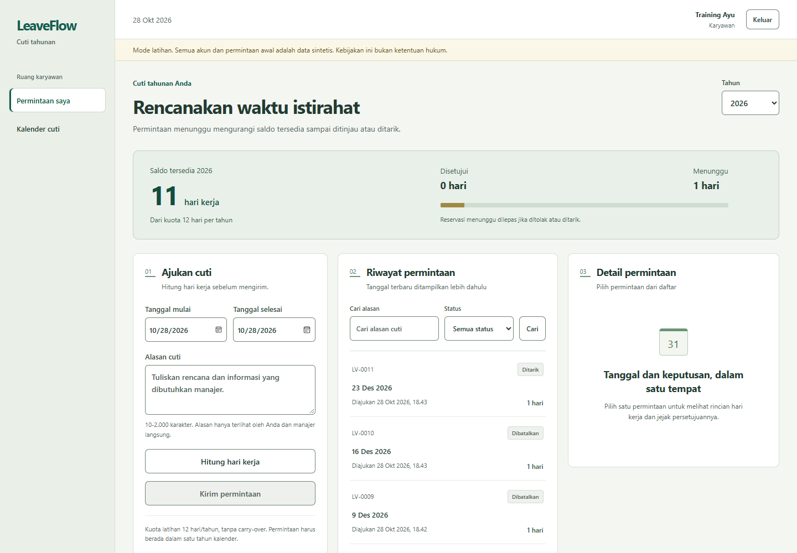
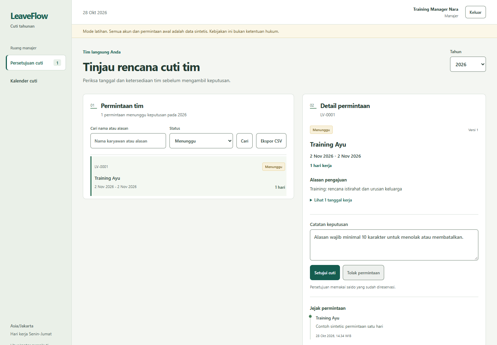
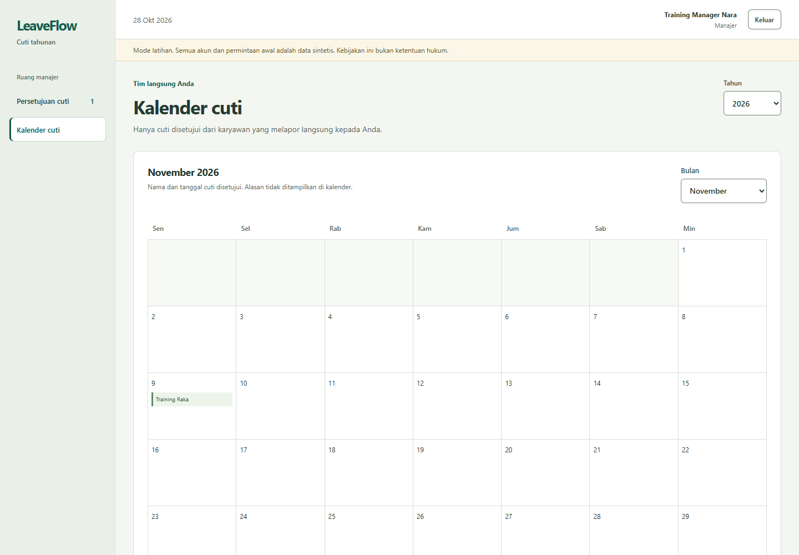
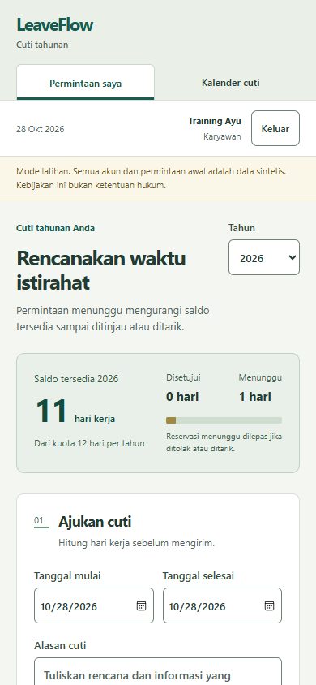

# LeaveFlow

Pengajuan cuti tahunan dengan reservasi saldo, persetujuan manajer langsung, dan kalender cuti. Proyek HRIS ini memusatkan perhatian pada satu aturan: dua permintaan yang dikirim bersamaan tidak boleh memakai saldo yang sama.

## Tampilan aplikasi

Screenshot nyata dari stack Docker dengan data Training. Akun dan pengajuan contoh bersifat sintetis.





<details><summary>Kalender cuti dan tampilan ponsel</summary>





</details>

## Mencoba di komputer sendiri

Prasyarat: Docker Desktop dengan Linux containers dan PowerShell. Jalankan dari folder proyek:

```powershell
git clone https://github.com/zalamanga/leaveflow-hris.git
cd leaveflow-hris
.\scripts\Start.ps1
```

Buka **http://localhost:8094**. Kata sandi latihan dibuat unik oleh skrip dan disimpan di `.local/LOCAL-CREDENTIALS.txt`. File tersebut tidak masuk Git.

| Akun sintetis | Peran |
| --- | --- |
| `employee@leaveflow.test` | Karyawan di bawah manager pertama |
| `colleague@leaveflow.test` | Rekan satu tim |
| `manager@leaveflow.test` | Manajer dua karyawan di atas |
| `manager2@leaveflow.test` | Manajer tim lain |
| `second@leaveflow.test` | Karyawan di bawah manager kedua |

```powershell
.\scripts\Stop.ps1
```

Perintah berhenti mempertahankan volume database. Jangan menggunakan `docker compose down -v` jika data latihan masih dibutuhkan.

## Alur yang dapat dicoba

1. Masuk sebagai karyawan. Pilih tanggal mulai dan selesai, tulis alasan, lalu hitung hari kerja.
2. Kirim pengajuan. Hari yang diminta masuk ke saldo **menunggu**, sehingga permintaan berikutnya tidak dapat menghabiskan kuota yang sama.
3. Masuk sebagai manajer. Buka permintaan anggota tim, periksa tanggal kerja dan alasan, lalu setujui atau tolak.
4. Lihat kalender. Hanya permintaan yang disetujui muncul; alasan pribadi tidak ditampilkan.
5. Karyawan dapat menarik permintaan menunggu. Manajer dapat membatalkan persetujuan dengan alasan minimal 10 karakter. Saldo kembali tersedia, dan keputusan tetap tercatat pada riwayat.

Manajer hanya melihat karyawan yang melapor langsung kepadanya, termasuk pada detail, pencarian, jumlah status, ekspor CSV, dan kalender. Karyawan hanya melihat data sendiri. Versi ini memakai akun manajer terpisah untuk peninjauan; manajer tidak mengajukan cuti sendiri.

## Aturan contoh

Ini **kebijakan latihan**, bukan perhitungan hak cuti menurut hukum atau sistem penggajian.

- Kuota awal contoh: 12 hari per tahun kalender, tanpa carry-over.
- Hari kerja: Senin-Jumat, dikurangi tanggal libur kantor yang dikonfigurasi.
- Libur kantor bawaan diberi label fiktif; aplikasi tidak menganggap daftar tersebut sebagai kalender hari libur nasional.
- Tanggal mulai tidak boleh sebelum hari ini di zona `Asia/Jakarta`.
- Satu pengajuan harus berada pada satu tahun kalender dan memuat setidaknya satu hari kerja.
- Rentang tanggal tidak boleh bertabrakan dengan pengajuan menunggu atau disetujui. Pemeriksaan rentang mencakup akhir pekan di antara tanggal mulai dan selesai.
- Server menghitung ulang hari kerja saat pengajuan dan menyimpan snapshot tanggal serta kebijakan. Perubahan kalender libur berikutnya tidak mengubah pengajuan lama.

`tersedia = kuota - disetujui - menunggu`. Persetujuan memindahkan reservasi menjadi penggunaan saldo, sehingga tidak mengurangi saldo dua kali.

## Teknologi dan struktur

FastAPI, SQLAlchemy, Alembic, PostgreSQL 17, React, TypeScript, Vite, dan Docker Compose. Frontend dan API dilayani pada origin yang sama. Akun memakai hash Argon2; sesi berupa token acak dengan hash di database, cookie HttpOnly, CSRF token, pemeriksaan Origin, dan batas percobaan login.

```text
backend/app/          model, kebijakan tanggal, API, CLI dan seed
backend/alembic/      migrasi skema
backend/tests/        hak akses, transaksi, autentikasi dan race PostgreSQL
frontend/src/        ruang karyawan, antrean manajer dan kalender
e2e/                 alur browser dan pengambilan screenshot
scripts/             menjalankan, menghentikan dan menguji lingkungan Docker
docs/                arsitektur, panduan kode dan bahan interview
```

## Dokumentasi

- [Arsitektur dan aturan transaksi](docs/ARCHITECTURE.md)
- [Panduan file, fungsi, API, dan CLI](docs/CODE-GUIDE.md)
- [Skenario penjelasan saat interview](docs/INTERVIEW.md)
- [Catatan pengujian dan batas pembuktian](docs/VERIFICATION.md)
- [Arah tampilan](docs/DESIGN.md)

## Pengujian

```powershell
.\scripts\Test.ps1
```

Pengujian browser dan pengambilan screenshot memakai kata sandi latihan dari variabel `APP_DEMO_PASSWORD`, bukan password di source. Lihat [catatan verifikasi](docs/VERIFICATION.md) untuk hasil aktual. Pengujian SQLite membantu memeriksa aturan, tetapi tidak membuktikan row lock PostgreSQL.

## Batas versi ini

Belum mencakup payroll, cuti setengah hari, lampiran medis, delegasi persetujuan, perubahan struktur pelaporan melalui UI, carry-over, SSO, atau integrasi kalender eksternal. Kuota dan tanggal libur dikelola melalui CLI. Jangan memasukkan data pribadi karyawan nyata ke deployment demo.
