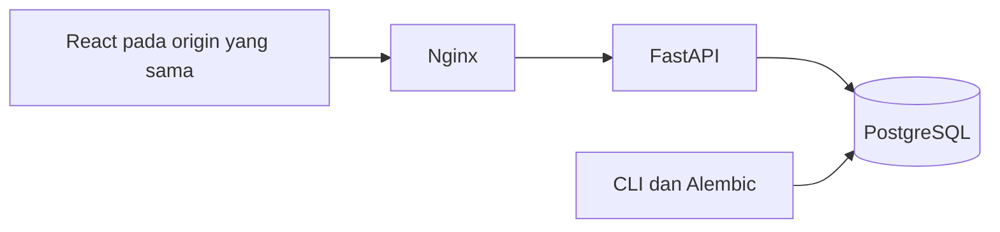
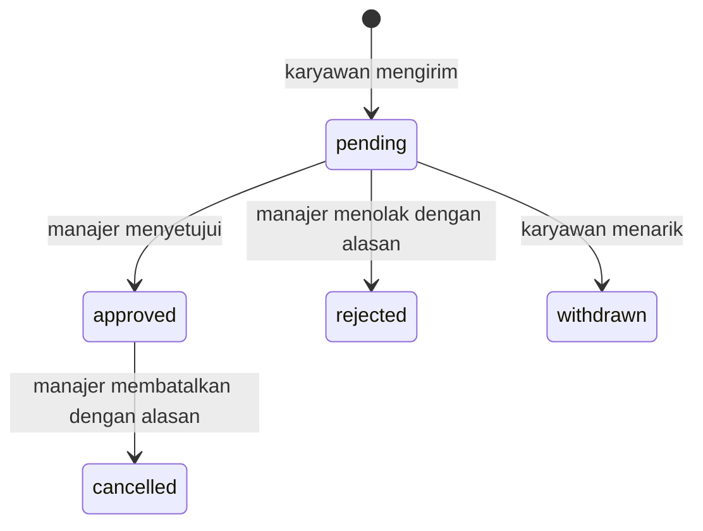

# Arsitektur LeaveFlow

## Aliran permintaan

Browser meminta sesi melalui `/api/auth/me`, memuat tanggal kantor dari `/api/leave/context`, lalu mengambil saldo dan daftar pengajuan. API tidak menerima identitas pemohon atau jumlah hari dari browser. Identitas berasal dari sesi; jumlah hari berasal dari kebijakan tanggal di server.

## Data

| Tabel | Tanggung jawab |
| --- | --- |
| `users` | Akun, peran, status aktif dan `manager_id` |
| `annual_grants` | Kuota satu karyawan untuk satu tahun, serta versi saldo |
| `company_holidays` | Tanggal dan label libur kantor yang dikonfigurasi |
| `leave_requests` | Rentang, snapshot tanggal kerja, jumlah hari, alasan, status dan versi |
| `audit_events` | Aktor, keputusan, catatan dan waktu setiap perubahan pengajuan |
| `sessions` | Hash token sesi, CSRF token dan kedaluwarsa |
| `rate_limit_buckets` | Penghitung percobaan login per email dan peer IP |
| `seed_markers` | Penanda bahwa seed sintetis telah selesai |

Grant memiliki pasangan `(employee_id, year)` yang unik. Constraint juga membatasi peran, status, kuota nonnegatif, rentang tanggal, dan versi positif. Aturan lintas baris seperti saldo dan overlap diperiksa di dalam transaksi dengan row lock.

## Reservasi dan persetujuan

Tidak ada penghapusan riwayat, pembukaan kembali, atau pengubahan rentang setelah dikirim. Untuk mengajukan tanggal lain, karyawan menarik pengajuan menunggu dan membuat pengajuan baru.

Pengajuan baru mengunci baris karyawan, lalu grant tahun terkait. Setelah lock diperoleh, server memeriksa versi grant yang dibaca browser, overlap aktif, dan sisa saldo. Pengajuan, event, dan kenaikan versi grant masuk ke transaksi yang sama.

Peninjauan terlebih dahulu mengidentifikasi karyawan melalui pengajuan yang dapat diakses. Urutan lock tetap **karyawan -> grant -> pengajuan**. Setelah itu server membaca ulang versi dan status pengajuan. Semua jalur memakai urutan yang sama untuk mencegah dua pengajuan berbeda dari karyawan yang sama menghabiskan satu saldo bersamaan.

Versi grant melindungi pengajuan dari tampilan saldo yang sudah lama. Versi pengajuan melindungi keputusan dari dua tab browser. Satu keputusan dapat berhasil; keputusan dengan versi lama mendapat `409`. Event ikut rollback bila perubahan gagal.

## Batas akses dan privasi

`visibility()` membatasi query database, bukan hanya menyembunyikan tombol. Karyawan mendapat predikat `employee_id == session.user_id`. Manajer mendapat subquery akun karyawan dengan `manager_id == session.user_id`.

Predikat ini digunakan pada daftar, hitungan, pencarian, detail, perubahan status, CSV dan kalender. Detail pengajuan tim lain memberi `404`. Akses endpoint khusus peran yang salah memberi `403`.

Kalender karyawan hanya berisi cuti sendiri yang disetujui. Kalender manajer berisi cuti disetujui dari tim langsung. Respons kalender tidak memuat alasan, komentar keputusan atau audit. CSV hanya berisi referensi, nama, tanggal, jumlah hari dan status. Nilai CSV dengan awalan formula dinetralkan.

## Sesi dan deployment

Token sesi mentah hanya ada pada cookie `leaveflow_session` dengan `HttpOnly`, `SameSite=Lax`, path `/api`, dan umur 24 jam. Database menyimpan SHA-256 dari token acak. Mutasi terautentikasi membutuhkan `X-CSRF-Token`; middleware memeriksa Origin yang persis diizinkan dan menolak `Sec-Fetch-Site: cross-site`.

Cookie Secure perlu diaktifkan pada HTTPS. Server menggunakan peer IP untuk limiter dan tidak mempercayai `X-Forwarded-For` dari pengguna. Deployment publik memerlukan batas request di proxy, TLS, backup dan pemantauan operasional. Akun contoh tetap data sintetis.
